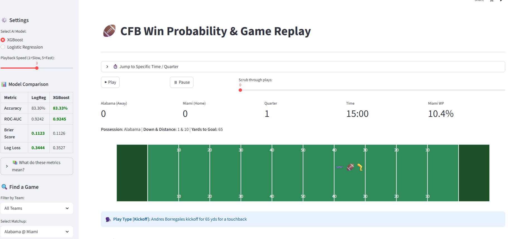

# College Football Win Probability Model

A play-by-play win probability model for FBS college football, trained on 1.72 million plays
and deployed as an interactive app that replays any game snap by snap.

**Live app:** https://cfb-win-probability.streamlit.app/
**Report:** [Final_Report.pdf](Final_Report.pdf) · **Presentation:** [Final presentation.pdf](Final%20presentation.pdf)

## What the app does

- Pick any game from the dataset and replay it play by play, or jump to any point.
- Watch win probability update after every snap, shown as one continuous line from the
  home team's point of view, like a broadcast graphic.
- Compare the two models (logistic regression and XGBoost) on the same game.
- See the **Play of the Game**, flagged automatically as the play with the largest
  win-probability swing for the winning team.

## Data

- **Source:** [CollegeFootballData.com](https://collegefootballdata.com), collected with the
  R package `cfbfastR`.
- **Coverage:** all FBS games from the 2017–2025 seasons, excluding 2020 (the shortened COVID
  season): eight seasons and 1,718,250 plays.
- **Cleaning:** removed 114 post-snap columns that would leak the outcome, dropped overtime
  plays, fixed the game clock to run continuously from 3,600 seconds to zero, corrected
  goal-to-go distances, and reframed every feature from the possession team's point of view.

## Approach

The model is built around features that encode how football works, rather than relying on
model complexity alone. The 24 features fall into four groups:

- **Game state:** down, distance, yards to goal, time remaining, score differential,
  timeouts, home field, Elo ratings and the Vegas spread.
- **Momentum:** drive yards, drive success rate, drive time and rolling EPA and yards over
  the last five plays.
- **Interactions:** for example, score differential × time elapsed (a lead matters more as
  time runs out) and spread × time remaining (pregame expectations fade as the game goes on).
- **Polynomial terms:** for example, squared score differential (a 14-point lead is far safer
  than twice a 7-point lead).

Train and test sets were split by game, so the model is always evaluated on games it has
never seen.

## Results

| Metric | Logistic regression | XGBoost |
|---|---|---|
| ROC-AUC | 0.925 | 0.926 |
| Brier score | 0.112 | 0.111 |
| Log loss | 0.344 | 0.349 |
| Accuracy | 83.3% | 83.5% |

The regularized logistic regression performs as well as a 500-tree XGBoost model. The
engineered features captured the non-linear structure of the game, so a simple, smooth model
was enough.

## Tech stack

Python, pandas, scikit-learn, XGBoost, statsmodels, Plotly and Streamlit.

## Author

Alvin Hampton
